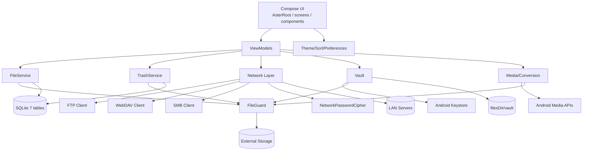

# Aster Files 架构设计

> 面向人类开发者的模块依赖、运行机制与安全边界。

## 模块依赖图



## 1. 本地文件模块

调用链：

    FilesScreen → FilesViewModel → FileService → FileGuard → File

关键点：

- FileService 只接受路径字符串，内部先 guardForRead/guardForWrite，再执行。
- listDirectory 过滤内部根（.trash/.aster-data/vault），不向 UI 暴露。
- 复制/移动/重命名/删除均生成 OperationResult/BatchResult，写入 AuditTrail。
- 删除调用 TrashService，不直接 File.delete。
- 完整性扫描在 IO 调度器运行，任务/结果写入 SQLite。

## 2. 网络流模块

    NetworkBrowserScreen
      → NetworkBrowserViewModel
      → NetworkClientFactory
      → Ftp/WebDav/Smb RemoteClient
      → RemoteEntry
      → NetworkTransferViewModel
      → TransferCenter（最多 3 并发）

- FTP 使用 Apache Commons Net，支持 PASSIVE + 进度回调。
- WebDAV 使用 OkHttp PROPFIND/MKCOL/MOVE/DELETE；httpUrl/authHeaders 提供直接流地址。
- SMB 使用 SMBJ，DiskShare 读写，目录重命名采用递归复制后删除。
- 密码由 KeystoreNetworkPasswordCipher 加密保存。
- 网络视频：WebDAV 用 DefaultHttpDataSource；FTP 用 FtpMediaDataSource 接入 ExoPlayer。
- 网络图片：WebDAV 直接 HTTP，FTP/SMB 经 RemoteImageLoader 读取字节。

## 3. 媒体库模块

- 图片：Coil 负责缩略图、全屏图片；ImageGalleryDialog 用 HorizontalPager 左右切换。
- 视频：Media3 ExoPlayer + PlayerView；VideoPlayerScreen 支持全屏/PiP。
- 音频：AudioPlaybackService (MediaSessionService) 后台播放、通知控制。
- 转换：BitmapFactory + Bitmap.compress；MediaExtractor + MediaMuxer/raw MP3。
- 清理扫描：EmptyDirectoryScanner、SimilarImageDetector、SpaceCleaner；最终统一 TrashService。

## 4. 隐私保险箱

    VaultScreen
      → VaultPinStore / BiometricPrompt
      → VaultManager
      → VaultCrypto（Android Keystore AES-256-GCM）
      → filesDir/vault

- 文件内容格式：AVLT + version + IV + ciphertext。
- 预览：图片/视频解密到 cacheDir/vault_preview，退出/锁定时清理；文本在内存解密。
- 自动上锁：Lifecycle ON_STOP 记录时间，ON_START 超过 60s 回到 PIN 界面；退出立即上锁。

## 5. 数据与审计

SQLite 7 表：meta、trash_entries、integrity_tasks、integrity_results、integrity_action_jobs、audit_log、compliance_meta。

审计写入由 AuditTrail 统一填充 auditId/timestamp/actor；服务层只描述业务字段。

## 6. 线程与生命周期

- 所有磁盘/网络/媒体操作在 Dispatchers.IO。
- ViewModel 使用 StateFlow；Compose collectAsStateWithLifecycle。
- TransferCenter 使用 Semaphore(3) + TransferGate 支持暂停/继续/取消。
- 视频 PiP 由 MainActivity.onUserLeaveHint + VideoPipState 控制；PiP 内只保留播放/暂停。
- Vault 生命周期由 VaultScreen 的 LifecycleEventObserver 管控。

## 7. 构建变体

```kotlin
release {
    isMinifyEnabled = true
    isShrinkResources = true
    signingConfig = signingConfigs.getByName("release")
    buildConfigField("boolean", "SHOW_OPEN_SOURCE", "false")
    buildConfigField("boolean", "ENABLE_CRASH_LOG", "false")
}
create("standardDebug") {
    initWith(getByName("debug"))
    isDebuggable = true
    buildConfigField("boolean", "SHOW_OPEN_SOURCE", "false")
    buildConfigField("boolean", "ENABLE_CRASH_LOG", "true")
}
```

## 8. 安全边界

- FileGuard 是唯一外部文件入口。
- 禁止跟随符号链接。
- 禁止根目录操作。
- ZIP 解压必须校验规范化路径前缀。
- Vault 明文不落盘；网络密码不明文。
- Release 禁止崩溃日志落盘；开源组件页面由 BuildConfig 控制。
